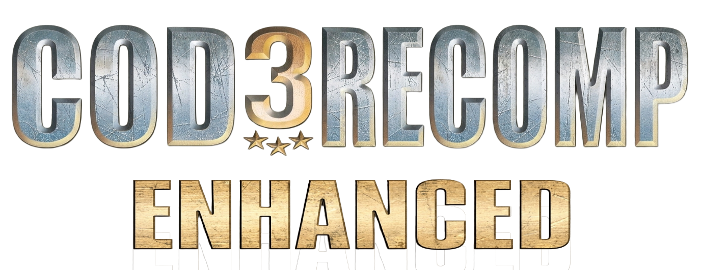

# 


**Call of Duty 3 (Xbox 360) on PC, with some shit I wanted fixed.**

This is my enhanced fork of CoD3Recomp, based on upstream **0.5.424**. I mainly give a shit about the **single-player campaign**, fixing annoyances and adding a few modern touches.

The game itself is **NOT INCLUDED**. You need your own Xbox 360 version of Call of Duty 3. Legal shit, I know.

If you want the technical write-up, [here's the formal README](docs/README-FORMAL-BACKUP.md).

## Credit where it's due

**[FrankHUN88453/CoD3Recomp](https://github.com/FrankHUN88453/CoD3Recomp) - [hovg-N8/CoD3Recomp](https://github.com/hovg-N8/CoD3Recomp) - [my fork](https://github.com/Whitetigercub/COD3RECOMP-ENHANCED)**

Frank started the recompilation project and PC renderer. hovg-N8 built a hell of a lot on top of it through 0.5.424. I didn't make their work and I'm not going to pretend I did.

The upstream project already has major campaign improvements, multiplayer features, bots, killstreaks, HDR options, performance changes, and more. **Those are NOT my additions.**

And to be clear, **I HAVE NOT TESTED MULTIPLAYER.** hovg-N8's fork has multiplayer functionality, but I'm working on the campaign, so I'm not going to claim I've personally verified that shit.

I've kept the older upstream READMEs in [docs/UPSTREAM-README.md](docs/UPSTREAM-README.md), and their big development history is in [docs/PATCH-NOTES.md](docs/PATCH-NOTES.md). No one's credits got thrown in the trash.

## MAIN CHANGES

- **Fixed three broken buttons:** RELOAD, BINOCULARS, and OBJECTIVES. Yes, basic buttons. They were busted.
- Added **mouse and keyboard button icons/prompts** to the UI.
- Added **native menu mouse support (preview)**: cursor-based hover and click detection instead of faking D-pad movement on mapped campaign menus. **Single Player hover, clicking, and empty-space rejection are playtested and confirmed.** Extended menu/dialog/options/pause coverage is still a work in progress.
- Added **modern COD-style hitmarkers**, with sound and customization. F11 - Gameplay.
- Added **M1 Garand partial reload**, because throwing away the whole clip behavior every time wasn't what I wanted.
- Added **experimental blood decals and adjustable blood clouds**. F11 - Gameplay - Blood & Gore. **CURRENTLY UNSTABLE.**
- Added experimental blood-decal projection filtering and rendering diagnostics.

## Known menu bugs — still need fixing

The mouse finally points at actual menu entries, but the preview still has three reported bugs:

- The game's own **brightness slider does not respond** to the mouse.
- **Sensitivity sliders can keep changing after one click.**
- Go from the title screen into the menus, then back to **PRESS ENTER**, and **Enter stops working**.

These are documented, **not fixed**. The confirmed Single Player build and the expanded playtest executable are preserved locally. Later help-caption/button-capture refinements in this source have not been live playtested. Campaign build and focused simulated-input checks passed, but the tests missed the native slider-repeat behavior; they aren't proof that the bugs above are solved. Full gameplay cursor-capture transitions and multiplayer remain unverified.

See the [menu preview status](docs/MENU-POINTER-PREVIEW.md) and [bug log with reproduction/source leads](docs/MENU-SLIDER-BUGS.md). The slider fixes are deferred for a small follow-up patch.

## THE KNOWN BUG: BLOOD DECALS KEEP FUCKING DISAPPEARING

The experimental blood decals are **buggy as hell**. Sometimes they're visible, sometimes they disappear. The exact cause is **STILL UNKNOWN**.

Here's what we actually know: real decals have been generated, and visible pixel writes have been confirmed. In a separate diagnostic build, a **synthetic test decal stayed visible for over three minutes**. The frozen source/copy depth coverage matched at **740/740 samples**, with **156 diagnostic checks and 27 normal-renderer checks passed**.

I've also seen blood stay on the ground after reloading a checkpoint. Nice, but **that does NOT mean the bug is fixed**.

In live rendering, normal depth testing has rejected some decal coverage while depth-disabled rendering showed coverage. That could be legitimate occlusion. It is **not proof** that depth testing is broken.

**Current suspects, NOT confirmed causes:** depth or camera-projection mismatch, depth-buffer timing, later render passes covering the blood, first-person weapon/foreground layering, resource-state issues, or MSAA interactions.

### Update: live blood comparison finished (November 2026)

Sol ran the same-frame comparison. **24 paired frames** were captured with matching fixture/projection hashes, and every measured draw call succeeded. **Seven frames had TWO blood insertions**, so counting each actual draw matters.

For **five consecutive live frames**, the test stain passed **317 normal-depth and 317 depth-disabled samples** at both the early and late checks, and **102 RGB pixels actually changed** in each frame. In other words, blood *can* draw correctly and stay there through the sampled rendering stages.

Other samples failed the **initial depth test** even though depth-disabled coverage was positive. That's a real observation, but **it does NOT prove the rejection was wrong**. Some captures involved foreground overlap or the Mission Failed screen, so those aren't evidence of blood mysteriously vanishing during normal gameplay.

The game sometimes copies the scene to a separate texture for display. Sol checked that the changed pixels fell inside the copied region and matched the selected presentation texture. **No later pass erasing blood was proven.**

The latest comparison build passed **168 diagnostic checks**, the developer-mode opt-out check, and **27 normal-renderer checks**. The installed executable/settings weren't changed. **The comparison code and patch are still local/archived, not committed or pushed to GitHub yet.**

**The actual bug is STILL UNSOLVED.** The next useful test is to catch a **real, gameplay-generated** blood stain going from visible to invisible on the same unobstructed surface, with Permanent decals enabled and the pool set to 4,096. Screenshot it before and after, and keep the settings and logs. No random renderer fixes based on a synthetic stain that behaves itself.
## BUT!

I HAVE A **PLAN B**: ISOLATED TESTING AREA, GRAY WALLS AND A STATIONARY ENEMY. **HAVEN'T TESTED** BUT IT'S A HYPOTHESIS.

For now, if the blood effects piss you off too, disable them in **F11 - Gameplay - Blood & Gore**.

## Building this thing (Windows)

You'll need your **own Xbox 360 game dump**, not files from this repo. The upstream build needs **CMake 3.20+**, **Ninja**, **Clang**, and **Visual Studio Build Tools / Windows SDK**. Clang is required here.

Put your own `default.xex` in `CoD3RecompLib/private/default.xex`. From the repo root, run:

```powershell
.\scripts\recompile.ps1 -BuildTools -BuildLib -BuildHost
```

Then run the built `CoD3.exe` from its output directory. On first launch, setup can use a disc image or an extracted game folder. To point it straight at an ISO, run this **from the executable's folder**:

```powershell
.\CoD3.exe --iso "D:\path\Call of Duty 3.iso"
```

These commands come from the existing upstream build script and README. I haven't freshly verified a clean build on every machine, so I'm not going to bullshit you about that. More details are in the [archived build instructions](docs/UPSTREAM-README.md#build) and [STATUS.md](STATUS.md).

## AI disclosure, just being clear

**This project was assisted with Codex and playtested by me.** You're free to dislike AI-assisted development, but I'd rather be transparent about my tools than pretend I didn't use them. Also this README was also written by Codex, haha. But this wasn't. Neither this. I'm not lying. I'm just wasting your time.

I still decide what goes into my fork, and I actually play the dang game.

Original game assets are not provided. Upstream code and third-party components keep their own attribution and licensing requirements. This README doesn't magically relicense anybody else's work.

If you're looking for some polished, bug-free miracle port, **this ain't it, bro**. I'm tinkering with a game I wanted to play on PC, fixing things as I go, and documenting the bugs instead of hiding them.
